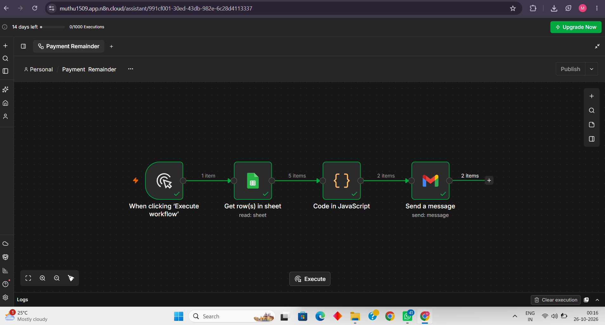
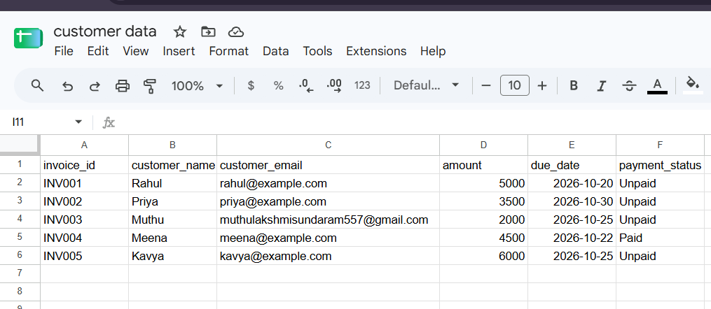
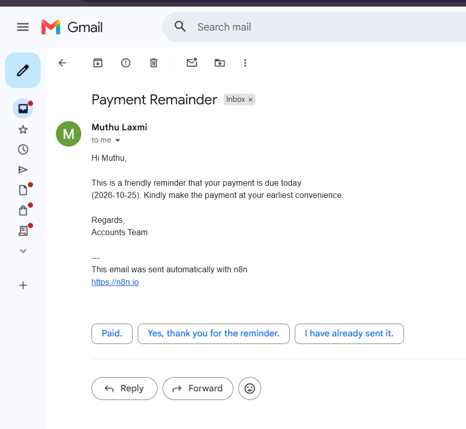
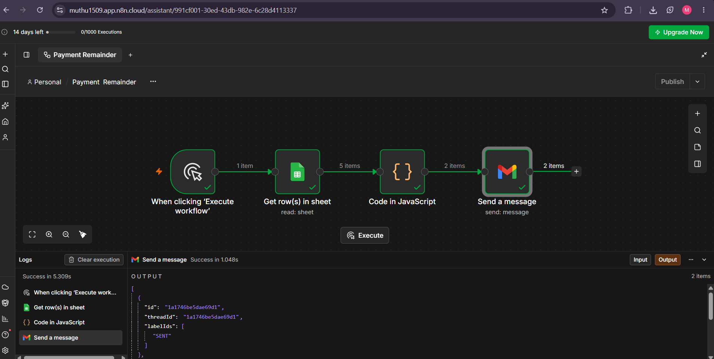

# Invoice Reminder Automation

## Overview

An invoice reminder automation workflow built using n8n, Google Sheets, JavaScript, and Gmail. It identifies invoices due today and sends personalized email reminders.

## Tech Stack

- n8n — Workflow automation
- Google Sheets — Invoice data storage
- JavaScript — Date-based filtering
- Gmail — Email notifications

## Workflow

1. Start the workflow manually.
2. Retrieve invoice records from Google Sheets.
3. Filter invoices based on today's date.
4. Generate a personalized reminder using customer details.
5. Send the reminder email through Gmail.

## Sample Email

Hi Customer,

This is a friendly reminder that your payment is due today. Kindly make the payment at your earliest convenience.

Regards,
Accounts Team

Future Improvements

- Exclude invoices that are already paid.
- Prevent duplicate reminder emails.
- Schedule automatic daily execution.
- Add overdue payment reminders.

## Project Screenshots

### 1. n8n Workflow

### 2. Invoice Data in Google Sheets

### 3. Successful Email Reminder

### 4. Workflow Execution Result

## Learning Outcomes

This project helped me practise workflow automation, Google Sheets integration, JavaScript filtering, and automated email notifications.

## Disclaimer

This project was built for learning purposes. All sample invoice records should be fictional, and sensitive information must not be shared publicly.
